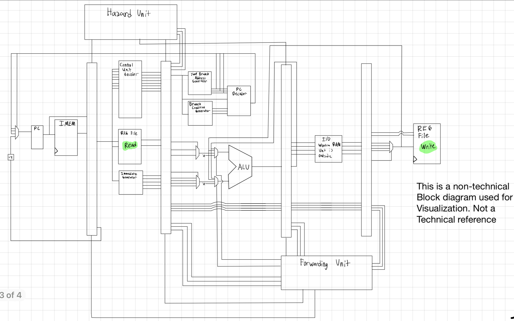
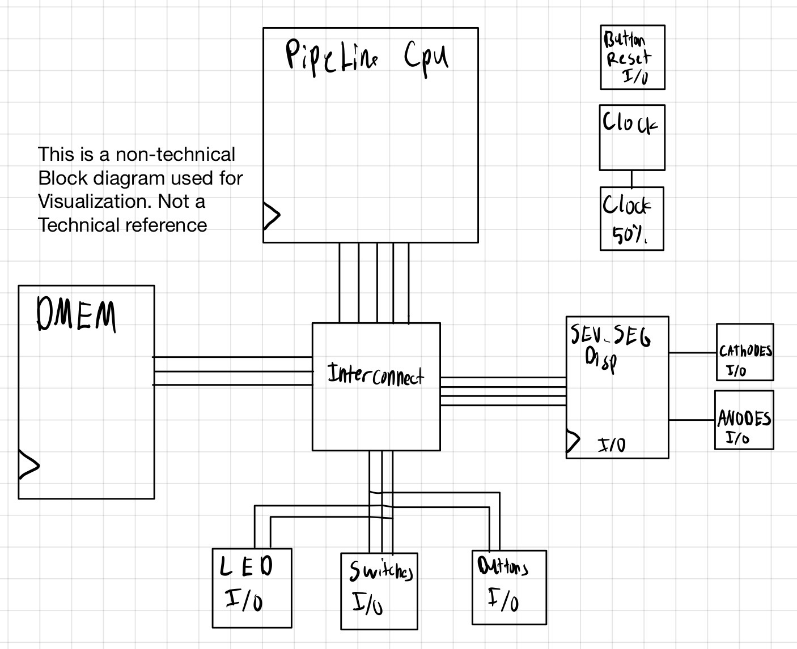

# RV32I Pipeline FPGA

A 5-stage pipelined RV32I processor that runs on a Basys 3. It implements 37 of the 40 base integer instructions, with hazard detection and forwarding, and was originally built as a CPE 333 class project at Cal Poly.

The CPU clock is 50 MHz, divided down from the board’s 100 MHz oscillator. Instruction memory and data memory are both synchronous: every read and every write happens on the clock edge, and the pipeline inserts no extra wait states for memory.

## What it does

- **ISA:** 37 of 40 RV32I instructions. The three left out are `FENCE`, `ECALL`, and `EBREAK`.
- **Pipeline:** fetch, decode, execute, memory, writeback.
- **Hazards:** the forwarding unit resolves RAW hazards in execute by taking a result from memory or writeback. A load that the next instruction needs stalls the pipe for one cycle. Taken branches, `jal`, and `jalr` flush the instructions already fetched behind them.
- **Board:** Basys 3. Switches, buttons, LEDs, and the four-digit seven-segment display sit on a memory-mapped I/O bus.
- **Author:** Drew Nakamura. See Credits for the two pieces that came from elsewhere.

## Diagrams

These are reference drawings of the CPU and the MCU wrapper. A wire in the drawing may not match the RTL one-for-one.

### CPU

### MCU

## Memory map

| Address | What it is |
| --- | --- |
| `0x11000000` | Switches (read) |
| `0x11000020` | LEDs (write) |
| `0x11000040` | Seven-segment display (write) |
| `0x11000080` | Buttons (read) |
| `0x00003F60` and up | Data memory. The word index is `(address - 0x3F60) >> 2`. |

Instruction memory is inside the CPU and is read by the program counter. Addresses below the data-memory base do nothing on the data bus.

Loads and stores are byte, halfword, or word. Loads are sign-extended or zero-extended from the registered word.

## Layout

| Path | Contents |
| --- | --- |
| `rtl/` | CPU, memories, forwarding, hazard unit, and the Basys 3 wrapper |
| `sw/` | Program image and a Verilator lint makefile |
| `tb/` | Module testbenches |
| `docs/` | Diagrams |

`MCU_WRAPPER` is the FPGA top. It divides the board clock to 50 MHz, holds the CPU, data memory, the I/O interconnect, and the display.

## Credits

All of the processor RTL is by Drew Nakamura, except the two items below.

**Seven-segment display.** `SevSegDisp`, `BCD`, and `CathodeDriver` were written by Paul Hummel at Cal Poly. They drive the Basys 3’s four-digit display in hex or decimal. They are used here as written.

**Data memory.** `DMEM` follows the Cal Poly memory module primarily written by J. Callenes and P. Hummel. This copy keeps that structure and differs in only a few places, so it matches this pipeline’s address base and its byte, halfword, and word accesses.
